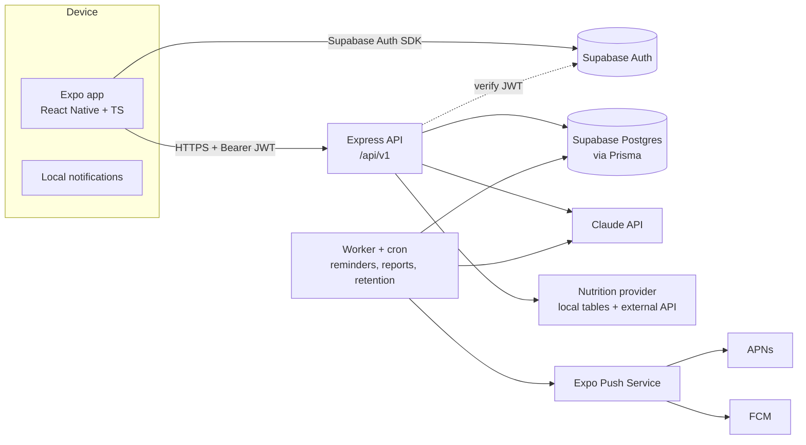

# 02 — Technical Architecture

## 1. Principles

1. **One app, one backend, one database, one AI integration.** No microservices, no multi-agent swarm.
2. **The AI never touches the database.** The backend owns tools, validation, authorization and persistence.
3. **Deterministic code for numbers, schedules, safety rules and permissions.** The LLM handles language and suggestions only.
4. **Model out of the critical path** for simple actions (logging water, computing averages).
5. **Vendors behind interfaces** — `LlmProvider`, `NutritionProvider`, `PushProvider` — so they can be swapped.

## 2. System diagram



## 3. Stack

| Layer | Choice | Notes |
|-------|--------|-------|
| Mobile | React Native, Expo (managed + dev builds), TypeScript, Expo Router | |
| UI | NativeWind (Tailwind) + small in-house component set | |
| Mobile data | TanStack Query (server cache), Zustand (UI state), MMKV/SecureStore | Tokens in SecureStore only |
| API | Node.js LTS, Express, TypeScript, Zod | |
| ORM | Prisma | Migrations in `apps/api/prisma/migrations` |
| DB | Supabase Postgres | RLS enabled as defence-in-depth |
| Auth | Supabase Auth | API verifies JWT (JWKS) on each request |
| AI | Claude API via `@anthropic-ai/sdk`, structured outputs + strict tools | Behind `LlmProvider` |
| Jobs | `pg-boss` (Postgres-backed durable queue) + cron | No extra infra; retries, singleton keys |
| Push | `expo-server-sdk` | Receipts polled for errors |
| Validation shared | `packages/shared` Zod schemas used by app and API | Single source of truth for contracts |
| Observability | Pino logs (redacted), Sentry, `ai_operations` table | |
| CI | GitHub Actions: lint, typecheck, test, prisma validate | EAS Build for mobile |

## 4. Repository layout (pnpm monorepo)

```
veya/
├─ apps/
│  ├─ mobile/                 # Expo app
│  │  ├─ app/                 # Expo Router routes
│  │  │  ├─ (auth)/           # sign-in, sign-up, reset
│  │  │  ├─ onboarding/
│  │  │  ├─ (tabs)/today.tsx | food/ | activity/ | insights/ | chat/
│  │  │  └─ settings/
│  │  ├─ components/ hooks/ lib/api.ts lib/notifications.ts
│  │  └─ app.config.ts
│  └─ api/
│     ├─ src/
│     │  ├─ server.ts  app.ts
│     │  ├─ middleware/       # auth, rateLimit, idempotency, errors, requestId
│     │  ├─ routes/v1/        # one file per resource
│     │  ├─ services/         # business logic (plans, logs, metrics, reports…)
│     │  ├─ agent/            # orchestrator, tools/, prompts/, safety/
│     │  ├─ providers/        # llm/, nutrition/, push/
│     │  ├─ jobs/             # worker.ts, reminders, reports, retention, deletion
│     │  └─ lib/              # time.ts (tz), prisma.ts, logger.ts, errors.ts
│     ├─ prisma/schema.prisma
│     └─ test/
├─ packages/
│  └─ shared/                 # Zod schemas, types, enums, constants (limits)
├─ supabase/                  # RLS policy SQL, seed
├─ docs/
└─ .github/workflows/
```

## 5. Request lifecycle

1. App obtains a Supabase access token; sends `Authorization: Bearer <jwt>`.
2. `requestId` middleware → `auth` middleware verifies JWT signature/expiry/audience via JWKS, sets `req.userId = sub`. **Any `user_id` in the body/query is ignored.**
3. `rateLimit` (per user + per IP) → `idempotency` (for POST with `Idempotency-Key`).
4. Zod validates params/query/body → service layer.
5. Service queries Prisma with `where: { userId: req.userId }` on every user-owned read/write.
6. Errors mapped to the standard error envelope (see [05-api-spec.md](05-api-spec.md)).

## 6. Data access & RLS

- The API connects with a DB role that bypasses RLS (Prisma), so **authorization is enforced in the service layer** and covered by tests.
- RLS is still enabled on all user tables with `auth.uid() = user_id` policies so that the anon key from the mobile app can never read other users' data even if someone calls Supabase directly. The mobile app does **not** query tables directly in the MVP — it only uses Supabase for auth.

## 7. Time zones

- All timestamps stored as `timestamptz` (UTC).
- Each user has an IANA zone in `profiles.timezone`.
- "Local date" queries use `lib/time.ts` helpers (built on `date-fns-tz` or Luxon): `localDayBounds(tz, date)`, `localWeekBounds(tz, weekStart)`.
- Day boundaries are computed per user; never use server local time.

## 8. Environments

| Env | DB | AI key | Push | Purpose |
|-----|----|--------|------|---------|
| local | Supabase local (CLI/Docker) or dev project | dev key | Expo Go/dev build | Developer machines |
| dev/staging | `lifehealth-dev` | dev key, low spend cap | dev builds | Internal QA |
| prod | `lifehealth-prod` | prod key | store builds | Beta + launch |

Feature flags (env or DB table): `AI_ENABLED`, `CHAT_ENABLED`, `PUSH_ENABLED`, `NUTRITION_EXTERNAL_API_ENABLED` — allow disabling AI instantly during an incident.

## 9. Configuration (API `.env`)

```
NODE_ENV=
PORT=
DATABASE_URL=
DIRECT_URL=
SUPABASE_URL=
SUPABASE_JWKS_URL=
SUPABASE_SERVICE_ROLE_KEY=
ANTHROPIC_API_KEY=
LLM_MODEL=claude-opus-5-5
NUTRITION_API_KEY=
EXPO_ACCESS_TOKEN=
SENTRY_DSN=
AI_DAILY_BUDGET_CALLS=40
AI_ENABLED=true
```

Validate env at boot with Zod; crash on missing values.
