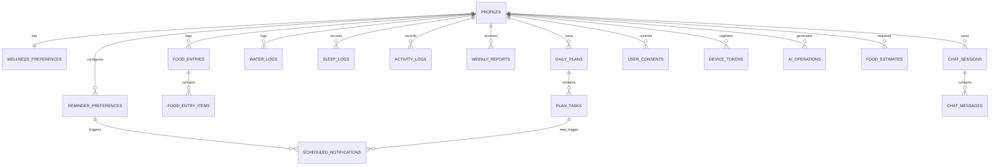

# 03 — Database Schema

PostgreSQL (Supabase) · UUID primary keys · `timestamptz` everywhere · explicit ownership · DB-level constraints · Prisma migrations.

## 1. Rules

1. Every user-owned row has `user_id` directly (preferred, even on child tables, to simplify RLS and deletion) or via an ownership-checked parent.
2. Server never trusts a client-supplied `user_id`.
3. RLS enabled and tested on every user table; service-role key never in the app.
4. UTC storage; reminder rules interpreted in the user's IANA zone.
5. Retryable writes use idempotency keys / unique constraints.
6. Nutrition values keep source + serving basis; unknown = `NULL`, never 0.
7. Retention policies for chat, images, operational logs.
8. AI-generated structured data stored separately from source logs; reports are recomputable.

## 2. Entity relationships



## 3. Prisma schema (draft)

```prisma
generator client { provider = "prisma-client-js" }

datasource db {
  provider  = "postgresql"
  url       = env("DATABASE_URL")
  directUrl = env("DIRECT_URL")
}

enum AgeBand        { AGE_18_24 AGE_25_34 AGE_35_44 AGE_45_54 AGE_55_64 AGE_65_PLUS }
enum PlanStatus     { DRAFT ACTIVE SUPERSEDED }
enum TaskCategory   { HYDRATION MEAL ACTIVITY SLEEP MINDFULNESS ROUTINE }
enum TaskStatus     { PROPOSED PENDING DONE SKIPPED SNOOZED }
enum TaskSource     { AI_PLAN CHAT USER TEMPLATE }
enum MealType       { BREAKFAST LUNCH DINNER SNACK }
enum LogSource      { MANUAL CHAT IMPORT }
enum EstimateSource { DATABASE_MATCH USER_ENTERED AI_ASSISTED_MATCH UNKNOWN }
enum ReminderCategory { HYDRATION MEALS ACTIVITY SLEEP PLAN_CHECKIN WEEKLY_REPORT TASK }
enum NotificationStatus { SCHEDULED SENDING SENT FAILED SKIPPED EXPIRED CANCELLED }
enum ChatRole       { USER ASSISTANT SYSTEM_NOTICE }
enum SafetyStatus   { OK REFERRAL URGENT BLOCKED }
enum ConsentType    { TERMS PRIVACY WELLNESS_DISCLAIMER AI_PROCESSING AI_PERSONAL_CONTEXT NOTIFICATIONS ANALYTICS }
enum AiOpType       { PLAN_GENERATE PLAN_ADJUST CHAT FOOD_PARSE REPORT_SUMMARY SAFETY_CHECK }
enum AiOpStatus     { STARTED SUCCEEDED FAILED REJECTED_VALIDATION REFUSED }
enum Platform       { IOS ANDROID }

model Profile {
  userId                 String    @id @map("user_id") @db.Uuid   // = auth.users.id
  displayName            String?   @map("display_name") @db.VarChar(60)
  ageBand                AgeBand?  @map("age_band")
  ageConfirmedAdultAt    DateTime  @map("age_confirmed_adult_at") @db.Timestamptz
  timezone               String    @db.VarChar(64)   // IANA, validated in app code
  locale                 String    @default("en-IN") @db.VarChar(16)
  onboardingCompletedAt  DateTime? @map("onboarding_completed_at") @db.Timestamptz
  deletionRequestedAt    DateTime? @map("deletion_requested_at") @db.Timestamptz
  createdAt              DateTime  @default(now()) @map("created_at") @db.Timestamptz
  updatedAt              DateTime  @updatedAt @map("updated_at") @db.Timestamptz
  @@map("profiles")
}

model WellnessPreferences {
  userId               String   @id @map("user_id") @db.Uuid
  goals                String[] // enum-validated in Zod: sleep, activity, meals, hydration, routine
  dietaryPreferences   Json     @map("dietary_preferences")   // { pattern: "vegetarian", allergies: [] }
  activityPreferences  Json     @map("activity_preferences")  // { likes: ["walk","yoga"], limitations_note: null }
  wakeTime             String?  @map("wake_time") @db.VarChar(5)   // "07:00" local
  bedtime              String?  @db.VarChar(5)
  waterGoalMl          Int?     @map("water_goal_ml")
  activityGoalMin      Int?     @map("activity_goal_min")
  sleepGoalMin         Int?     @map("sleep_goal_min")
  quietHoursStart      String   @default("22:00") @map("quiet_hours_start") @db.VarChar(5)
  quietHoursEnd        String   @default("07:00") @map("quiet_hours_end") @db.VarChar(5)
  maxRemindersPerDay   Int      @default(6) @map("max_reminders_per_day")
  updatedAt            DateTime @updatedAt @map("updated_at") @db.Timestamptz
  @@map("wellness_preferences")
}

model DailyPlan {
  id          String     @id @default(uuid()) @db.Uuid
  userId      String     @map("user_id") @db.Uuid
  planDate    DateTime   @map("plan_date") @db.Date        // user-local date
  version     Int        @default(1)
  status      PlanStatus @default(ACTIVE)
  source      TaskSource @default(AI_PLAN)
  summary     String?    @db.VarChar(300)
  planJson    Json       @map("plan_json")                 // validated AI output, kept for audit
  promptVersion String?  @map("prompt_version") @db.VarChar(20)
  createdAt   DateTime   @default(now()) @map("created_at") @db.Timestamptz
  updatedAt   DateTime   @updatedAt @map("updated_at") @db.Timestamptz
  tasks       PlanTask[]
  @@unique([userId, planDate, version])
  @@index([userId, planDate])
  @@map("daily_plans")
}
// Partial unique index (raw SQL migration): one ACTIVE plan per user per day
// CREATE UNIQUE INDEX daily_plans_one_active ON daily_plans(user_id, plan_date) WHERE status = 'ACTIVE';

model PlanTask {
  id           String       @id @default(uuid()) @db.Uuid
  planId       String?      @map("plan_id") @db.Uuid
  userId       String       @map("user_id") @db.Uuid
  category     TaskCategory
  title        String       @db.VarChar(120)
  reason       String?      @db.VarChar(200)
  scheduledAt  DateTime?    @map("scheduled_at") @db.Timestamptz
  status       TaskStatus   @default(PENDING)
  source       TaskSource
  completedAt  DateTime?    @map("completed_at") @db.Timestamptz
  snoozedUntil DateTime?    @map("snoozed_until") @db.Timestamptz
  createdAt    DateTime     @default(now()) @map("created_at") @db.Timestamptz
  updatedAt    DateTime     @updatedAt @map("updated_at") @db.Timestamptz
  plan         DailyPlan?   @relation(fields: [planId], references: [id], onDelete: Cascade)
  @@index([userId, scheduledAt])
  @@map("plan_tasks")
}

model FoodEntry {
  id             String     @id @default(uuid()) @db.Uuid
  userId         String     @map("user_id") @db.Uuid
  mealType       MealType   @map("meal_type")
  consumedAt     DateTime   @map("consumed_at") @db.Timestamptz
  source         LogSource  @default(MANUAL)
  notes          String?    @db.VarChar(500)
  idempotencyKey String?    @map("idempotency_key") @db.VarChar(64)
  createdAt      DateTime   @default(now()) @map("created_at") @db.Timestamptz
  updatedAt      DateTime   @updatedAt @map("updated_at") @db.Timestamptz
  items          FoodEntryItem[]
  @@unique([userId, idempotencyKey])
  @@index([userId, consumedAt])
  @@map("food_entries")
}

model FoodEntryItem {
  id              String         @id @default(uuid()) @db.Uuid
  foodEntryId     String         @map("food_entry_id") @db.Uuid
  userId          String         @map("user_id") @db.Uuid
  foodReference   String?        @map("food_reference") @db.VarChar(100) // "ifct:A001", "fdc:123456"
  foodName        String         @map("food_name") @db.VarChar(120)
  quantity        Decimal        @db.Decimal(8, 2)
  unit            String         @db.VarChar(20)        // "piece","katori","g","ml","cup"
  servingWeightG  Decimal?       @map("serving_weight_g") @db.Decimal(8, 2)
  calories        Decimal?       @db.Decimal(8, 1)      // NULL = unknown
  proteinG        Decimal?       @map("protein_g") @db.Decimal(7, 1)
  carbsG          Decimal?       @map("carbs_g") @db.Decimal(7, 1)
  fatG            Decimal?       @map("fat_g") @db.Decimal(7, 1)
  fiberG          Decimal?       @map("fiber_g") @db.Decimal(7, 1)
  estimateSource  EstimateSource @map("estimate_source")
  confidence      String?        @db.VarChar(10)       // "high" | "medium" | "low"
  basisNote       String?        @map("basis_note") @db.VarChar(200) // "IFCT per 100 g, standard recipe"
  entry           FoodEntry      @relation(fields: [foodEntryId], references: [id], onDelete: Cascade)
  @@index([foodEntryId])
  @@map("food_entry_items")
}

model FoodEstimate {   // unconfirmed estimates, short-lived
  id          String   @id @default(uuid()) @db.Uuid
  userId      String   @map("user_id") @db.Uuid
  inputText   String   @map("input_text") @db.VarChar(500)
  resultJson  Json     @map("result_json")
  expiresAt   DateTime @map("expires_at") @db.Timestamptz   // now() + 24h
  createdAt   DateTime @default(now()) @map("created_at") @db.Timestamptz
  @@index([userId, createdAt])
  @@map("food_estimates")
}

model WaterLog {
  id             String    @id @default(uuid()) @db.Uuid
  userId         String    @map("user_id") @db.Uuid
  amountMl       Int       @map("amount_ml")     // CHECK 1..2000
  loggedAt       DateTime  @map("logged_at") @db.Timestamptz
  source         LogSource @default(MANUAL)
  idempotencyKey String?   @map("idempotency_key") @db.VarChar(64)
  createdAt      DateTime  @default(now()) @map("created_at") @db.Timestamptz
  @@unique([userId, idempotencyKey])
  @@index([userId, loggedAt])
  @@map("water_logs")
}

model SleepLog {
  id             String    @id @default(uuid()) @db.Uuid
  userId         String    @map("user_id") @db.Uuid
  startedAt      DateTime  @map("started_at") @db.Timestamptz
  endedAt        DateTime  @map("ended_at") @db.Timestamptz   // CHECK ended_at > started_at AND <= 20h
  quality        Int?      // 1..5 optional self-rating
  source         LogSource @default(MANUAL)
  idempotencyKey String?   @map("idempotency_key") @db.VarChar(64)
  createdAt      DateTime  @default(now()) @map("created_at") @db.Timestamptz
  @@unique([userId, idempotencyKey])
  @@index([userId, endedAt])
  @@map("sleep_logs")
}

model ActivityLog {
  id              String    @id @default(uuid()) @db.Uuid
  userId          String    @map("user_id") @db.Uuid
  activityType    String    @map("activity_type") @db.VarChar(30)  // enum-validated in Zod
  durationMinutes Int       @map("duration_minutes")   // CHECK 1..600
  steps           Int?                                  // CHECK 0..100000
  distanceM       Int?      @map("distance_m")          // CHECK 0..200000
  loggedAt        DateTime  @map("logged_at") @db.Timestamptz
  source          LogSource @default(MANUAL)
  idempotencyKey  String?   @map("idempotency_key") @db.VarChar(64)
  createdAt       DateTime  @default(now()) @map("created_at") @db.Timestamptz
  @@unique([userId, idempotencyKey])
  @@index([userId, loggedAt])
  @@map("activity_logs")
}

model ReminderPreference {
  id         String           @id @default(uuid()) @db.Uuid
  userId     String           @map("user_id") @db.Uuid
  category   ReminderCategory
  localTimes String[]         @map("local_times")    // ["10:00","13:00","16:00"]
  daysOfWeek Int[]            @map("days_of_week")   // 1=Mon..7=Sun (ISO)
  enabled    Boolean          @default(true)
  updatedAt  DateTime         @updatedAt @map("updated_at") @db.Timestamptz
  @@unique([userId, category])
  @@map("reminder_preferences")
}

model ScheduledNotification {
  id            String             @id @default(uuid()) @db.Uuid
  userId        String             @map("user_id") @db.Uuid
  category      ReminderCategory
  taskId        String?            @map("task_id") @db.Uuid
  scheduledAt   DateTime           @map("scheduled_at") @db.Timestamptz
  expiresAt     DateTime           @map("expires_at") @db.Timestamptz
  status        NotificationStatus @default(SCHEDULED)
  dedupeKey     String             @unique @map("dedupe_key") @db.VarChar(160)
  attempts      Int                @default(0)
  lastError     String?            @map("last_error") @db.VarChar(200)
  pushTicketIds String[]           @map("push_ticket_ids")
  sentAt        DateTime?          @map("sent_at") @db.Timestamptz
  createdAt     DateTime           @default(now()) @map("created_at") @db.Timestamptz
  @@index([status, scheduledAt])
  @@index([userId, scheduledAt])
  @@map("scheduled_notifications")
}

model WeeklyReport {
  id                String   @id @default(uuid()) @db.Uuid
  userId            String   @map("user_id") @db.Uuid
  weekStart         DateTime @map("week_start") @db.Date
  weekEnd           DateTime @map("week_end") @db.Date
  metricsJson       Json     @map("metrics_json")       // deterministic aggregates
  summary           String?  @db.Text                   // AI text (validated)
  suggestionsJson   Json?    @map("suggestions_json")
  metricsVersion    Int      @map("metrics_version")
  generationVersion Int      @default(1) @map("generation_version")
  dataFingerprint   String   @map("data_fingerprint") @db.VarChar(64) // hash of underlying row counts/updated_at
  generatedAt       DateTime @default(now()) @map("generated_at") @db.Timestamptz
  @@unique([userId, weekStart, generationVersion])
  @@map("weekly_reports")
}

model ChatSession {
  id        String        @id @default(uuid()) @db.Uuid
  userId    String        @map("user_id") @db.Uuid
  title     String?       @db.VarChar(80)
  createdAt DateTime      @default(now()) @map("created_at") @db.Timestamptz
  lastMessageAt DateTime? @map("last_message_at") @db.Timestamptz
  messages  ChatMessage[]
  @@index([userId, createdAt])
  @@map("chat_sessions")
}

model ChatMessage {
  id           String       @id @default(uuid()) @db.Uuid
  sessionId    String       @map("session_id") @db.Uuid
  userId       String       @map("user_id") @db.Uuid
  role         ChatRole
  content      String       @db.Text
  actionsJson  Json?        @map("actions_json")   // proposed tasks/log confirmations shown as cards
  safetyStatus SafetyStatus @default(OK) @map("safety_status")
  clientMessageId String?   @map("client_message_id") @db.VarChar(64)
  createdAt    DateTime     @default(now()) @map("created_at") @db.Timestamptz
  session      ChatSession  @relation(fields: [sessionId], references: [id], onDelete: Cascade)
  @@unique([sessionId, clientMessageId])
  @@index([sessionId, createdAt])
  @@map("chat_messages")
}

model AiOperation {
  id            String     @id @default(uuid()) @db.Uuid
  userId        String?    @map("user_id") @db.Uuid    // nulled on account deletion
  operationType AiOpType   @map("operation_type")
  status        AiOpStatus
  model         String     @db.VarChar(60)
  promptVersion String     @map("prompt_version") @db.VarChar(20)
  inputHash     String     @map("input_hash") @db.VarChar(64)   // sha256, no raw prompt
  inputTokens   Int?       @map("input_tokens")
  outputTokens  Int?       @map("output_tokens")
  latencyMs     Int?       @map("latency_ms")
  errorCode     String?    @map("error_code") @db.VarChar(60)
  createdAt     DateTime   @default(now()) @map("created_at") @db.Timestamptz
  @@index([userId, createdAt])
  @@index([operationType, createdAt])
  @@map("ai_operations")
}

model DeviceToken {
  id         String   @id @default(uuid()) @db.Uuid
  userId     String   @map("user_id") @db.Uuid
  pushToken  String   @unique @map("push_token") @db.VarChar(200)
  platform   Platform
  enabled    Boolean  @default(true)
  lastSeenAt DateTime @map("last_seen_at") @db.Timestamptz
  createdAt  DateTime @default(now()) @map("created_at") @db.Timestamptz
  @@index([userId])
  @@map("device_tokens")
}

model UserConsent {
  id          String      @id @default(uuid()) @db.Uuid
  userId      String      @map("user_id") @db.Uuid
  consentType ConsentType @map("consent_type")
  version     String      @db.VarChar(20)
  grantedAt   DateTime    @map("granted_at") @db.Timestamptz
  revokedAt   DateTime?   @map("revoked_at") @db.Timestamptz
  @@index([userId, consentType])
  @@map("user_consents")
}

model IdempotencyRecord {
  key          String   @db.VarChar(64)
  userId       String   @map("user_id") @db.Uuid
  route        String   @db.VarChar(80)
  responseCode Int      @map("response_code")
  responseBody Json     @map("response_body")
  createdAt    DateTime @default(now()) @map("created_at") @db.Timestamptz
  @@id([userId, key])
  @@map("idempotency_records")
}

model DataExport {
  id          String    @id @default(uuid()) @db.Uuid
  userId      String    @map("user_id") @db.Uuid
  status      String    @db.VarChar(20)   // queued|ready|expired|failed
  storagePath String?   @map("storage_path")
  expiresAt   DateTime? @map("expires_at") @db.Timestamptz
  createdAt   DateTime  @default(now()) @map("created_at") @db.Timestamptz
  @@map("data_exports")
}
```

Food reference data lives in separate, non-user tables: `foods` (id, source, source_ref, name, aliases[], per_100g nutrients, licence) and `portion_units` (food_category, unit, grams). See [06-nutrition.md](06-nutrition.md).

## 4. Raw SQL to add in migrations (Prisma can't express these)

```sql
-- Check constraints
ALTER TABLE water_logs    ADD CONSTRAINT water_amount_range CHECK (amount_ml BETWEEN 1 AND 2000);
ALTER TABLE sleep_logs    ADD CONSTRAINT sleep_order CHECK (ended_at > started_at AND ended_at - started_at <= interval '20 hours');
ALTER TABLE activity_logs ADD CONSTRAINT activity_duration CHECK (duration_minutes BETWEEN 1 AND 600);
ALTER TABLE activity_logs ADD CONSTRAINT activity_steps CHECK (steps IS NULL OR steps BETWEEN 0 AND 100000);
ALTER TABLE food_entry_items ADD CONSTRAINT nutrients_non_negative CHECK (
  (calories IS NULL OR calories >= 0) AND (protein_g IS NULL OR protein_g >= 0) AND
  (carbs_g IS NULL OR carbs_g >= 0) AND (fat_g IS NULL OR fat_g >= 0));

-- One active plan per local day
CREATE UNIQUE INDEX daily_plans_one_active ON daily_plans(user_id, plan_date) WHERE status = 'ACTIVE';

-- Foreign keys to auth.users for cascade on deletion
ALTER TABLE profiles ADD CONSTRAINT profiles_user_fk FOREIGN KEY (user_id) REFERENCES auth.users(id) ON DELETE CASCADE;
-- every other user table: FOREIGN KEY (user_id) REFERENCES profiles(user_id) ON DELETE CASCADE
-- (ai_operations: ON DELETE SET NULL)
```

## 5. Row Level Security

Apply to every user table (template):

```sql
ALTER TABLE water_logs ENABLE ROW LEVEL SECURITY;
CREATE POLICY "own rows select" ON water_logs FOR SELECT USING (auth.uid() = user_id);
CREATE POLICY "own rows insert" ON water_logs FOR INSERT WITH CHECK (auth.uid() = user_id);
CREATE POLICY "own rows update" ON water_logs FOR UPDATE USING (auth.uid() = user_id) WITH CHECK (auth.uid() = user_id);
CREATE POLICY "own rows delete" ON water_logs FOR DELETE USING (auth.uid() = user_id);
```

Tables with **no client access at all** (RLS enabled, no policies): `ai_operations`, `scheduled_notifications`, `idempotency_records`, `food_estimates`, `data_exports`.

Test RLS with two test users using the anon key (pgTAP or a Jest suite) — see [10-testing-qa.md](10-testing-qa.md).

## 6. Retention

| Data | Retention | Job |
|------|-----------|-----|
| `food_estimates` (unconfirmed) | 24 h | hourly purge |
| Meal photos (Phase 2) | Deleted after processing unless opted-in | n/a in MVP |
| `chat_messages` | 180 days default; user can delete sessions anytime | daily purge |
| `ai_operations` | 90 days | daily purge |
| `scheduled_notifications` (terminal) | 30 days | daily purge |
| `idempotency_records` | 48 h | hourly purge |
| `data_exports` files | 7 days | daily purge |
| Account deletion | Hard delete all rows within 7 days (soft-flag immediately, block access) | deletion worker |
| Backups | Provider PITR window; document in privacy policy | — |
