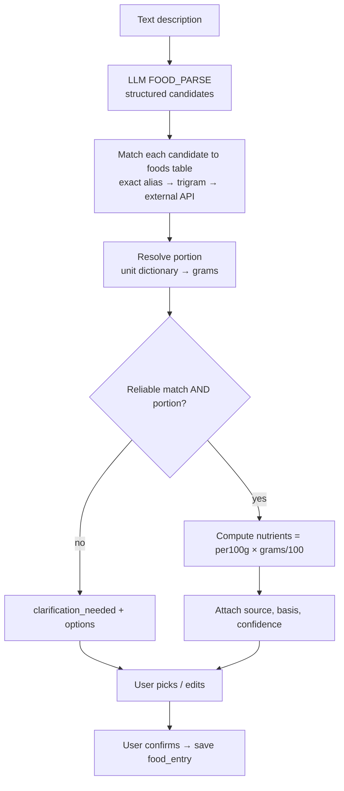

# 06 — Nutrition Estimation

Goal: useful, honest estimates. The AI interprets descriptions; **numbers come from reference data and arithmetic**.

## 1. Pipeline



## 2. Step details

### 2.1 Parse (LLM, structured output)
```ts
const ParsedMeal = z.object({
  items: z.array(z.object({
    name: z.string().max(80),            // "roti"
    qualifiers: z.array(z.string()).max(5), // ["homemade","whole wheat","with ghee"]
    quantity: z.number().positive().max(50).nullable(),
    unit: z.string().max(20).nullable(), // "medium","bowl","katori","g"
    preparation: z.string().max(60).nullable(),
  })).max(15),
  ambiguities: z.array(z.string().max(120)).max(5),
});
```
The LLM must **not** output nutrient values. Any numbers other than quantity are discarded.

### 2.2 Match
1. Normalise (lowercase, transliteration aliases: "chapati"="roti"="phulka").
2. Exact alias in `foods.aliases` → confidence high.
3. `pg_trgm` similarity ≥ 0.45 → medium; return top 3 as options if close scores.
4. Optional external API lookup (packaged/restaurant foods) → medium/low.
5. No match → `no_match`, ask user to search or enter manually.

### 2.3 Portion resolution
- `portion_units(food_category, unit, grams, source)`, e.g. `flatbread/medium=40g`, `dal/katori=150g`, `rice/cup_cooked=160g`.
- Unknown unit or missing quantity → clarification with 2–3 options.
- Household units are approximate — confidence never "high" when derived from a household unit for composite dishes.

### 2.4 Compute
`nutrient = per_100g × grams / 100`, rounded: calories to 5 kcal, macros to 0.5 g. Totals = sum of items with values; report coverage ("3 of 4 items estimated"). Never treat unknown as 0.

### 2.5 Confidence

| Situation | Confidence |
|-----------|-----------|
| Single-ingredient food, weight in g | high |
| Standard dish, standard portion unit | medium |
| Homemade/restaurant composite, oil unknown | low (label "rough estimate") |

## 3. Reference data

### `foods` table
| Column | Notes |
|--------|-------|
| id, source (`ifct`, `fdc`, `off`, `local_recipe`), source_ref | provenance |
| name, aliases[] , category | |
| kcal_100g, protein_100g, carbs_100g, fat_100g, fiber_100g (nullable) | |
| is_composite, recipe_basis_note | e.g. "toor dal, 1 tsp oil per serving" |
| licence, updated_at | |

### Sources (verify licences before use — see manual checklist F1)
- **IFCT 2017** (ICMR-NIN) — Indian ingredients.
- **USDA FoodData Central** — broad coverage, public domain.
- **Open Food Facts** — packaged products (ODbL).
- **Local recipes** — ~200 common Indian dishes computed from ingredients and reviewed by a nutritionist.

## 4. UX rules

- Every value shows "≈" and a tap-to-see basis ("Based on standard recipe, 1 katori ≈ 150 g").
- "Rough estimate" badge for low confidence.
- Edit quantity/unit inline → recompute instantly (client calls estimate again or uses returned per-gram values).
- Manual override saved as `USER_ENTERED`.
- No calorie targets or "good/bad food" labels in MVP.

## 5. Accuracy testing

50-meal test set (manual checklist F4): measure % items matched, % needing clarification, median absolute error vs nutritionist estimate on calories. Track per release.

## 6. Phase 2: photos
Add image → candidate items via vision model → same match/portion pipeline. Delete images after processing unless opted-in.
