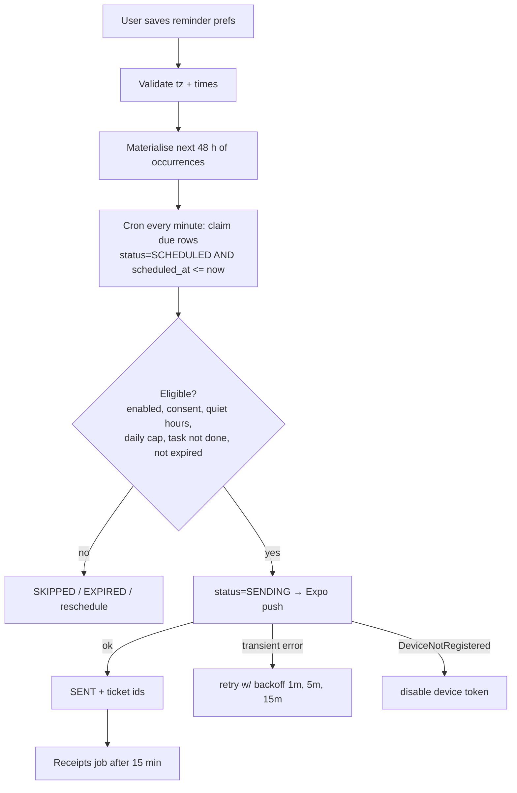

# 07 — Reminders & Scheduled Jobs

## 1. Model

- **Rules** (`reminder_preferences`): what the user wants, in local time.
- **Occurrences** (`scheduled_notifications`): concrete UTC instants generated from rules and tasks, each with a stable `dedupe_key`.
- Rules change → future unsent occurrences are cancelled and regenerated.

## 2. Lifecycle

## 3. Jobs (pg-boss)

| Job                     | Schedule                       | What it does                                                                            |
| ----------------------- | ------------------------------ | --------------------------------------------------------------------------------------- |
| `materialise-reminders` | every 30 min + on prefs change | For each user, create occurrences for next 48 h (idempotent via `dedupe_key`)           |
| `dispatch-due`          | every minute                   | Claim up to N due rows with `FOR UPDATE SKIP LOCKED`, check eligibility, send           |
| `push-receipts`         | every 15 min                   | Fetch Expo receipts, mark failures, disable bad tokens                                  |
| `daily-plan-prep`       | hourly                         | For users whose local time is 05:00, pre-generate today's plan (optional; else on open) |
| `weekly-report`         | hourly                         | For users whose local time is Monday 08:00, generate last week's report                 |
| `retention-purge`       | hourly/daily                   | Retention table in [03](03-database.md#6-retention)                                     |
| `account-deletion`      | every 10 min                   | Process pending deletions                                                               |
| `data-export`           | on demand                      | Build export file                                                                       |

## 4. Rules

- **Dedupe key**: `{user_id}:{category}:{task_id|rule}:{local_date}:{local_time}` — unique index prevents duplicates even if materialisation runs twice.
- **Claiming**: `UPDATE … SET status='SENDING' WHERE id IN (SELECT id … FOR UPDATE SKIP LOCKED LIMIT 100) RETURNING *` — safe with multiple workers.
- **Time zone**: convert local `HH:mm` on local date → UTC using the user's IANA zone at that date (DST-correct). Non-existent local times (spring-forward) shift forward to the next valid minute; repeated times (fall-back) use the first occurrence.
- **Quiet hours**: occurrence inside quiet hours → skip (or move to end of quiet hours for plan check-in only).
- **Daily cap**: count SENT for local date ≥ `max_reminders_per_day` → SKIPPED.
- **Expiry**: `expires_at = scheduled_at + 30 min` (hydration) / `+2 h` (others). After an outage, expired rows become EXPIRED — no backlog bursts.
- **Task-linked**: skip if task already DONE; snooze creates a new occurrence with `dedupe_key` suffix `:snooze:{n}` and cancels the old one.
- **Push disabled** (permission off or no tokens): occurrences still drive in-app "pending" list; nothing is sent.
- **No AI** in the notification path. Copy comes from templates.

## 5. Local vs push

| Use local notifications (`expo-notifications` scheduling)               | Use server push                                                                  |
| ----------------------------------------------------------------------- | -------------------------------------------------------------------------------- |
| Fixed daily hydration/meal reminders when the device is the only target | Plan-task reminders, weekly report ready, follow-ups that depend on server state |

MVP choice to keep one source of truth: **server push for everything**, with local notifications as a fallback when push permission is granted but no token is registered (e.g. registration failed). Avoid scheduling both for the same occurrence.

## 6. Notification copy (templates)

| Category      | Title               | Body                                    |
| ------------- | ------------------- | --------------------------------------- |
| Hydration     | Time for some water | Log a glass when you're ready.          |
| Meals         | Meal check-in       | Tap to log what you ate.                |
| Activity      | A little movement?  | Your plan has a short activity for now. |
| Sleep         | Wind-down time      | Start getting ready for bed.            |
| Plan check-in | Your plan for today | See today's small steps.                |
| Weekly report | Your week in review | Your weekly summary is ready.           |

No health values, goals or symptoms on the lock screen. No urgency language.
